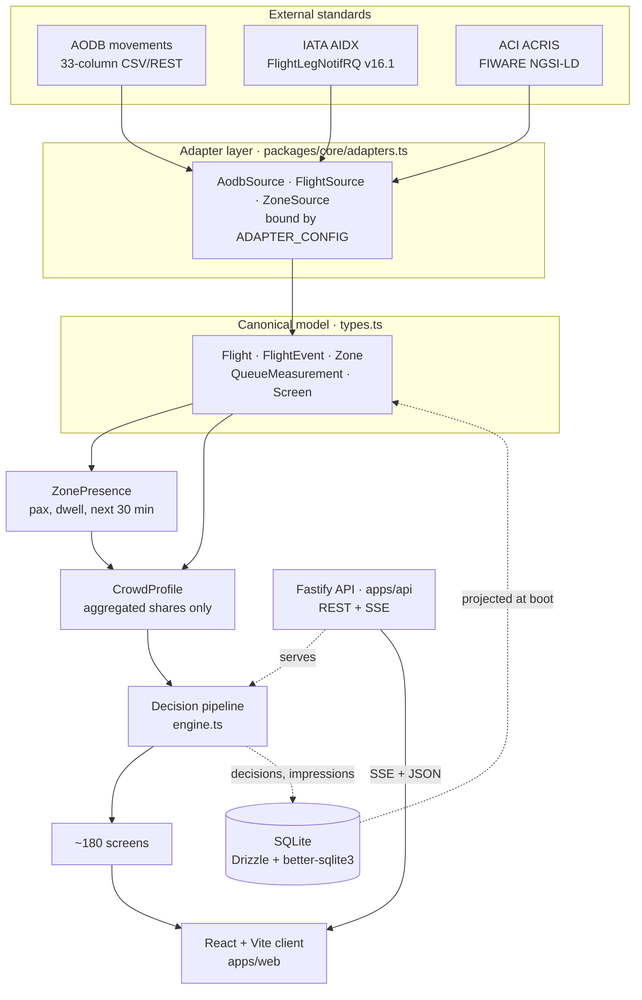
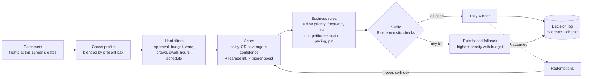

# AURA — technical architecture

## What this is

AURA decides which advert plays on which airport screen, and it decides it from the passengers who
are actually standing in front of that screen rather than from a schedule bought weeks earlier. The
one idea the whole system hangs on is that passenger presence is a *derived* signal, not a measured
one: departures in the AODB tell you how many people will be at a gate and roughly who they are,
IATA AIDX tells you when that changes, ACI ACRIS queue sensors correct the model where they happen
to be looking, and the three are blended into a `ZonePresence` and a per-screen `CrowdProfile` of
aggregated shares. A scoring model then proposes a campaign against that profile, and a
deterministic verifier sits between the model and the screen: it re-resolves every flight the
proposal cited against the AODB snapshot, ages every input against its feed's freshness budget,
re-runs the hard rules, recomputes the score from the logged inputs and confirms an approved
creative exists. If any check fails the proposal is discarded and a rule-based default plays
instead. Nothing reaches a screen on the model's word alone.

## The system



Read it left to right as a one-way translation. Each external standard has exactly one adapter
class, chosen by one environment value (`FLIGHT_SOURCE`, `ZONE_SOURCE`, `AODB_SOURCE`). Going live
against a real feed means writing one class behind the existing interface and changing one value;
nothing downstream of the canonical model knows which vendor produced anything. The stubs for the
live variants are already in place and throw a message naming the credentials they want.

## The decision pipeline



The filter runs before the score, but every filtered campaign is still scored afterwards so the log
can record what it *would* have made — that counterfactual is what turns the log into something a
media owner can argue with. Business rules act on the score rather than replacing it, and each one
records the rule, its effect and its reason on the `CampaignScore`. The learning loop is a single
number: a redemption moves the campaign's `cvrIndex`, which feeds the capped additive lift term in
the next score, so a campaign that converts earns its next slot rather than being given it.

## Package layout

```
aura-airport-retail-media/
├── packages/core/            the domain: no HTTP, no React, no database
│   ├── src/types.ts          the canonical model and the three adapter interfaces
│   ├── src/reference.ts      theme, engine constants, segment catalogue, airport reference data
│   ├── src/util.ts           seeded RNG, rounding, the simulated day's clock constants
│   ├── src/world.ts          deterministic generator for one day: flights, screens, campaigns
│   ├── src/adapters.ts       AODB, AIDX and ACRIS adapters plus the ADAPTER_CONFIG switch
│   ├── src/engine.ts         presence, profile, scoring, filters, business rules, verifier, decide()
│   └── test/                 the worked example asserted exactly, so the demo cannot drift
├── apps/api/                 Fastify server, the simulation clock, and every write
│   ├── src/schema.ts         the Drizzle SQLite schema — the system of record
│   ├── src/db.ts             connection, migrations, and the boot-time projection into World
│   ├── src/store.ts          every write the platform makes, in one fire-and-forget module
│   ├── src/sim.ts            the clock, the feeds it drives, decisions, injections, the event bus
│   ├── src/routes.ts         the REST surface and the SSE stream
│   ├── src/ai.ts             pluggable creative provider, offline template engine by default
│   └── src/seed.ts           writes the generated day into SQLite
├── apps/api/drizzle/         generated SQL migrations on disk, applied idempotently at boot
└── apps/web/                 React client: five role surfaces over one API
    ├── src/lib/              typed API wrapper, the single EventSource, query keys, i18n
    └── src/components/       terminal map, screen preview, the "why" panel, transport bar
```

The split matters in one specific way: `packages/core` has no imports from Node, the browser or the
database, so the identical scoring code runs on the server to make the decision and in the browser
to preview what a campaign *would* score before anyone buys it. There is no second implementation
to keep in step.

## Runtime: one tick

The clock fires every 500 ms of real time and advances the simulated clock by that interval times
the speed multiplier. On each tick, in order:

1. Advance `sim.now`, clamping at the end of the operating day.
2. If the simulated minute changed, run the flight state machine: every departure moves between
   scheduled, delayed, boarding, final and departed against its own timestamps, and each transition
   emits an AIDX message onto the feed and an audit row into SQLite.
3. On every fifth simulated minute, sweep ACRIS: publish a `QueueMeasurement` NGSI-LD entity per
   zone, derived from modelled presence with sensor noise, and store it.
4. Check for goodwill: any departure now more than an hour late gets a voucher pushed once, co-funded
   with a nearby coffee outlet.
5. Check screen health: any screen silent for more than five minutes raises a critical incident, once.
6. Rebuild decisions for a set of screens, then emit `tick` on the event bus.

Step 6 is the one that needs justifying. Decisions are computed server-side, never in the client,
because every role has to see the same screen playing the same advert for the same stated reasons —
a decision computed in a browser is an opinion, not a record. But recomputing all 178 screens every
tick is wasted work, since most screens are not being looked at and most of their inputs did not
move. So the rebuild takes the union of two sets: every screen a client has opened (fetching a
screen's decision marks it watched, and it stays in the set), plus a rotating sample of seven taken
by striding through the estate with a persistent cursor. A full rebuild of twenty-six screens is
forced whenever something invalidates everything at once — a clock jump, an injection, a campaign
edit, a creative approval. The effect is that the screens on show are always current to the slot,
while the decision log still fills with genuine decisions from across the whole estate rather than
from the same handful. Persistence is sampled too: one decision in eight is written to SQLite, which
keeps the log representative without hammering the disk at sixty times real speed.

## Why this stack

**TypeScript end to end.** The canonical model in `types.ts` is the contract between the adapters,
the engine, the database projection and the client. One language means it is one declaration rather
than three that drift; it is also why the campaign builder can score a draft in the browser with the
same function the server uses.

**Fastify.** The hot path is a JSON serialiser and an SSE writer. Fastify gives both with a small
dependency surface and typed route generics, and its `reply.raw` is a plain Node response, so the
event stream is thirty lines rather than a framework integration. In production the same server also
serves the built client, so the whole product is one container on one port.

**Drizzle with better-sqlite3.** The database is embedded: there is nothing to provision, no
container to wait for, no credentials in a reviewer's environment, and `npm run db:reset` is a file
deletion. better-sqlite3 is synchronous, which suits a boot-time projection and fire-and-forget
audit writes with no promise plumbing. Drizzle generates real SQL migrations that live on disk under
`apps/api/drizzle/` and are applied idempotently at boot, so the schema is reviewable as SQL rather
than inferred from an ORM at runtime, and the same schema file is the source of the TypeScript types.

**React with Vite.** Five role surfaces over one API, with component state that genuinely changes
every few seconds; a declarative view layer is the right fit and TanStack Query handles the
invalidation the event stream drives. Vite is chosen for the dev loop and for its proxy, which puts
the API on the same origin in development so the SSE connection behaves exactly as it does in
production.

**Server-sent events rather than WebSocket.** Every live update in this product travels one way,
server to client: ticks, decisions, plays, scans, redemptions, incidents, injections. A WebSocket
would buy a return channel nothing needs, in exchange for a second protocol, an upgrade handshake
that corporate proxies and load balancers interfere with, and reconnection logic written by hand.
SSE is ordinary HTTP with a content type, so it survives proxies, and `EventSource` reconnects by
itself. Writes go over the REST surface that already exists. A `: ping` comment every twenty seconds
keeps intermediaries from closing an idle stream, and listeners are detached when the request closes.

## Performance

A decision is one slot's work for one screen: fifteen seconds of airtime, recomputed no more often
than that and served from cache within the slot. The presence and profile window is five minutes,
which is also the ACRIS sweep interval, so the sensor correction is never older than the window it
corrects.

The world is held in memory. SQLite is the system of record, but at boot the API projects the whole
day — flights, screens, zones, campaigns, creatives, promotions — into one `World` object, and the
engine works only over that. Scoring touches every campaign and every flight in a screen's catchment
on every slot for every watched screen; going to disk for any of that would make the slot cadence
the database's problem. Writes go the other way as they happen, so the record stays current without
the read path ever touching it.

Sixty-times speed is cheap because of what a tick actually costs. The expensive parts are gated: the
flight state machine and the ACRIS sweep run on simulated-minute boundaries, not per tick, so
speeding the clock does not multiply them by the frame rate — it coalesces them. Decision rebuilds
are bounded by the sampling strategy above rather than by estate size. Persistence is sampled one in
eight. And the generated day is a pure function of one seed, so there is no data loading, no network
and no non-determinism anywhere in the loop; the same reviewer at the same timestamp sees the same
airport, which is what makes the worked-example test an assertion rather than an approximation.

## Privacy

There is no personal data in this system, and that is a property of the model rather than a policy
laid over it. The only description of an audience anywhere in the codebase is `CrowdProfile`, and
every field on it is a share of a crowd: purpose, party composition, age bands, cabin, region,
nationality and language, each a proportion between zero and one. There is no identifier, no
timestamp of an individual's movement and no field that could carry one.

The crowds themselves are aggregates by flight, by zone and by time window. A flight's profile is a
property of the leg, not of its manifest. A zone's profile is those flight profiles blended by how
many of their passengers the model puts in the zone during a five-minute window. A screen's profile
is the same blend over the flights at the gates that screen faces. The smallest unit anything is
computed over is a flight's worth of people.

Nothing in the system reads a boarding pass, a loyalty number, a passport, a phone, a MAC address, a
camera or a Bluetooth beacon. The ACRIS input is a `QueueMeasurement`: a count of people and an
average waiting time for a zone, with no per-person record behind it. The redemption ledger records
a code, a campaign, a screen and a segment label — what was claimed and against which campaign,
never by whom. `CrowdProfile` is where this is enforced: adding a field to it that cannot be
expressed as a share of a crowd is the change that would break the guarantee, and it is a change
that has to be made deliberately, in one file, in full view.
